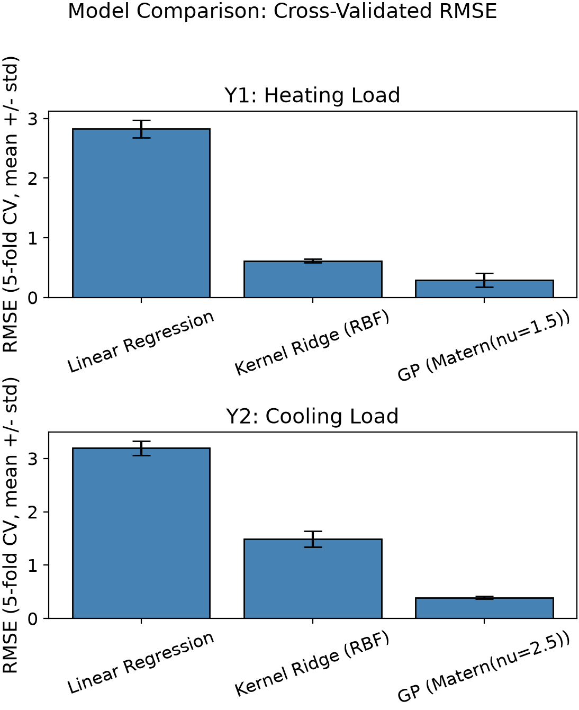
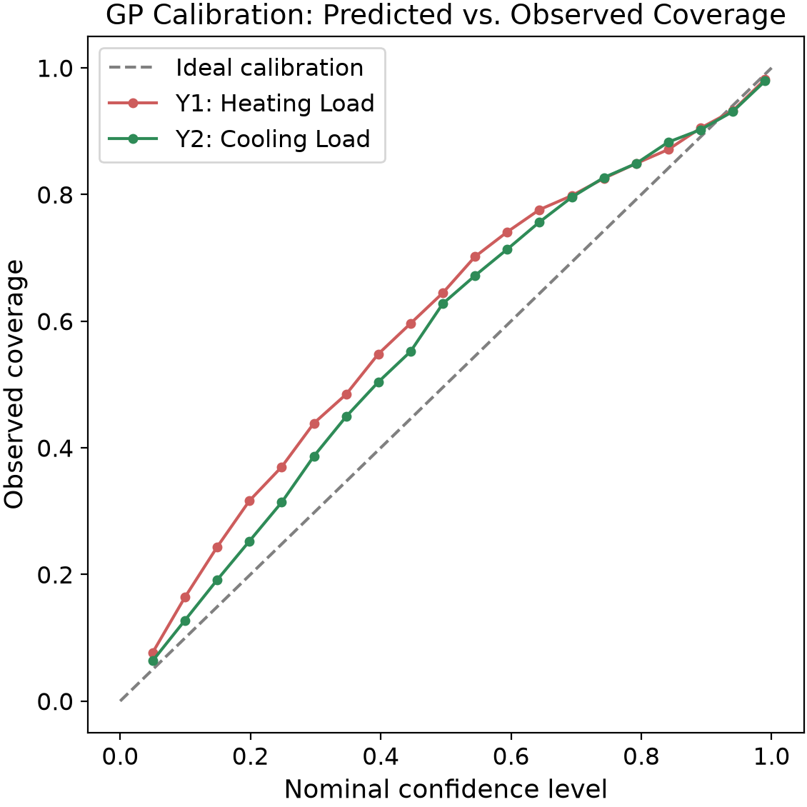

# Energy Efficiency: Gaussian Process Regression

Gaussian Process Regression (GPR) as a surrogate model for predicting the
heating and cooling loads of residential buildings from eight building design
features, using the UCI Energy Efficiency dataset (Tsanas and Xifara, 2012).

Final project for *Python for Engineering Data Analysis* (TUM, SS 2026).

**[Read the full report (PDF)](report.pdf)**

## Research question

How accurately can a GPR surrogate model predict residential heating and
cooling loads compared with simpler regression models, and how reliable is
the predictive uncertainty it reports?

## Key results

GPR with an anisotropic Matern kernel reduces the error by a factor of 5.6
over a tuned Kernel Ridge model for the heating load, and by a factor of 2.7
for the cooling load. All values are 5-fold cross-validated.

| Model | Y1 heating RMSE | Y1 R2 | Y2 cooling RMSE | Y2 R2 |
|---|---|---|---|---|
| Linear Regression | 2.944 | 0.913 | 3.206 | 0.885 |
| Kernel Ridge (RBF) | 2.603 | 0.932 | 1.626 | 0.970 |
| **GPR (Matern, ARD)** | **0.462** | **0.998** | **0.611** | **0.996** |



Two ablation studies isolate what actually drives this result:

- **Kernel family.** Irrelevant for the heating load, but Matern clearly
  beats RBF for the cooling load (0.611 versus 0.745) and is far more stable
  across folds.
- **Automatic Relevance Determination.** The decisive choice. Removing ARD
  roughly doubles the cooling-load error. The learned length scales are
  physically interpretable: orientation barely affects the heating load,
  roof area barely affects the cooling load.

Beyond point accuracy, the predictive intervals were validated against their
nominal coverage. The model is moderately conservative at intermediate
confidence levels and slightly too narrow in the tails, but close enough to
nominal to be usable. Error bars widen in sparsely sampled regions, which is
the property that motivates GPR for surrogate modelling in the first place.



## Setup

```bash
pip install -r requirements.txt
```

The dataset is included in `data/`. It can also be fetched from the UCI
Machine Learning Repository:

```bash
python fetch_data.py
```

## Reproducing the analysis

```bash
python eda.py                     # exploratory data analysis and figures
python gpr_model_selection.py     # RBF versus Matern kernels
python baselines.py               # Linear Regression, KRR and GPR
python isotropic_comparison.py    # ARD versus isotropic kernels
python uncertainty.py             # interval calibration and coverage
```

Note that `baselines.py` runs nested cross-validation and takes roughly
45 minutes on a laptop CPU. Numerical results are written to `results/` and
figures to `figures/`.

`gpr_baseline.py` contains the initial single-split implementation that the
final analysis grew out of.

## Method notes

- Features are standardised inside each cross-validation fold using only the
  training partition, so no information leaks into validation.
- Kernel Ridge hyperparameters are tuned by nested grid search, so the
  comparison against GPR is fair rather than a straw man.
- The dataset is a factorial simulation design, not a random sample. The
  reported errors therefore describe interpolation within a regular grid and
  not generalisation to arbitrary buildings. This and other limitations are
  discussed in the report.

## Team

- Bruno Ams
- Murilo Siqueira Ferreira Monte
